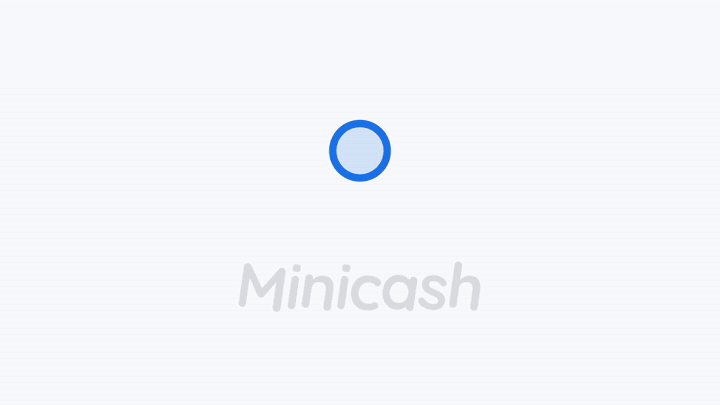

# Minicash

Aplicación Android de finanzas personales, pensada para llevar el dinero del día a día en pareja o en lo individual. Todo vive en el dispositivo: sin cuentas, sin servidores y sin enviar datos a ningún lado.

Hecha con Kotlin, Jetpack Compose y Material 3 Expressive. Las ideas a futuro están en [docs/hoja-de-ruta.md](docs/hoja-de-ruta.md).

[](docs/promo/minicash-promo.mp4)

<sub>Vista previa sin sonido; el [video completo con música](docs/promo/minicash-promo.mp4) está en `docs/promo/`, junto con su proyecto fuente en [Hyperframes](https://hyperframes.heygen.com).</sub>

## Qué hace

- **Inicio.** Patrimonio total, tus cuentas en un carrusel (cada una abre su detalle) y la distribución de gastos e ingresos por categoría. Un selector de mes permite revisar meses anteriores; por defecto muestra el mes en curso.
- **Movimientos.** Gastos, ingresos y transferencias entre cuentas, organizados por mes, con búsqueda (recuerda las búsquedas recientes) y filtros. El botón de agregar despliega Gasto, Ingreso o Transferencia, y borrar ofrece "Deshacer".
- **Detalle de cuenta.** Saldo, cambio del saldo en los últimos 6 meses y los movimientos de esa cuenta.
- **Gastos fijos.** Presupuesto por quincenas: partidas de ingreso, gasto y reembolso en cuadrícula, con resumen de lo disponible y barra de avance. Se marcan como ejecutadas, se reordenan con pulsación larga y se pueden copiar de una quincena a otra.
- **Créditos.** Compras a meses con avance por mensualidad, fecha estimada de término y aviso antes de cada pago. El día de pago se configura en la institución (tarjeta o banco) y las compras lo heredan; cada compra puede usar otro día.
- **Reportes.** Dashboard con balance del periodo y tasa de ahorro, ingresos contra gastos por mes (6 o 12 meses), gasto por categoría, balance acumulado y desglose mensual.
- **Copias de seguridad.** Exportación e importación en JSON, con copia automática opcional. Los movimientos también se exportan a CSV (este mes, últimos 3 meses, este año o todo) para hojas de cálculo.
- **Extras.** Centro con tarjetas de resumen hacia Gastos fijos, Créditos y Reportes; los módulos que ocultes no aparecen. Ajustes queda en el engrane de arriba a la derecha.
- **Widgets.** Uno con patrimonio, gasto del mes y botones de registro, y otro solo con los botones de gasto, ingreso y transferencia.
- **Privacidad.** Opción para ocultar la vista previa en multitarea (también bloquea capturas de pantalla) y bloqueo de la app con la huella, el rostro o el PIN del teléfono, que se pide al abrir o tras un tiempo fuera de la app.
- **Personalización.** Tema claro, oscuro o AMOLED, color dinámico o de acento, barra de navegación integrada o flotante (se oculta al desplazar) y módulos opcionales de Gastos fijos y Créditos.

## Privacidad

Los datos se guardan únicamente en una base de datos local (Room) del dispositivo. La app no pide cuenta, no usa red para tus finanzas y las copias de seguridad las guardas tú donde prefieras. El bloqueo opcional lo resuelve el sistema: la app solo recibe si la verificación tuvo éxito.

## Instalación

1. Descarga el APK más reciente de la sección de *Releases* (o compílalo tú, ver más abajo).
2. Ábrelo en tu teléfono y permite la instalación desde ese origen si Android lo pide.
3. En la primera apertura, un asistente de bienvenida te guía para empezar.

Requiere Android 8.0 (API 26) o superior.

## Compilar

Necesitas Android Studio reciente o el JDK y el SDK de Android configurados.

```bash
./gradlew :app:testDebugUnitTest
./gradlew :app:installDebug
./gradlew :app:assembleRelease
```

En Windows usa `gradlew.bat`. El APK release queda en `app/build/outputs/apk/release/`.

La firma de release usa `~/.android/debug.keystore`. Si compilas en otra computadora, copia ese archivo a la misma ruta antes del primer build; así el APK sigue instalándose como actualización de las versiones anteriores.

## Tecnología

| Área | Elección |
|---|---|
| Lenguaje y UI | Kotlin, Jetpack Compose, Material 3 Expressive |
| Datos | Room (con migraciones y esquemas exportados en `app/schemas`) |
| Ajustes | DataStore |
| Bloqueo | AndroidX Biometric (huella, rostro o PIN del sistema; nada sale del dispositivo) |
| Tareas en segundo plano | WorkManager (avisos de pago y copias automáticas) |
| Widgets | Jetpack Glance |
| Respaldos | Gson, formato JSON versionado |
| Reordenar listas | `sh.calvin.reorderable` |

## Estructura

```
app/src/main/java/com/uramos/minicash/
├── data/       base de datos, entidades, respaldos, preferencias y workers
├── ui/
│   ├── components/   botones, tarjetas, diálogos y gráficas reutilizables
│   ├── navigation/   pantalla principal y barra de navegación
│   ├── screens/      inicio, historial, gastos fijos, créditos, reportes y ajustes
│   └── theme/        colores, tipografía, formas y movimiento
└── MainActivity.kt
```

Más detalle de diseño y contratos entre capas en [DESIGN.md](DESIGN.md) y [CONTRACTS.md](CONTRACTS.md).

## Pruebas

Las pruebas unitarias cubren el cálculo de fechas de pago y la herencia entre institución y compra, el teclado numérico y el formato compacto de montos, el contraste de colores, el efecto de cada movimiento sobre los saldos (y que borrar y restaurar se cancelen), los totales mensuales por cuenta, el CSV (escape, fórmulas y periodos), las búsquedas recientes y la regla del bloqueo.

```bash
./gradlew :app:testDebugUnitTest
```

## Estado

Proyecto personal en uso diario. Está en versión 1.0.0. Las versiones siguen [SemVer](https://semver.org/lang/es/): correcciones `1.0.x`, funciones nuevas `1.x.0`; cada release sube también `versionCode` en `app/build.gradle.kts` y lleva un tag `vX.Y.Z`.

## Licencia

[MIT](LICENSE).
